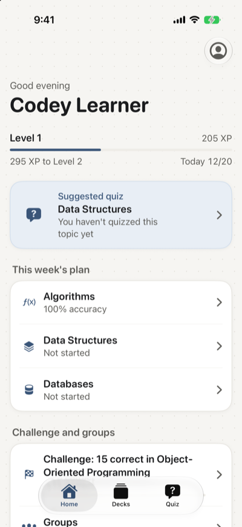
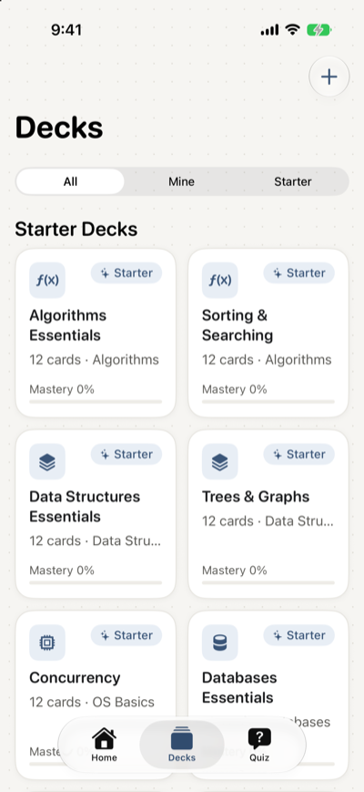
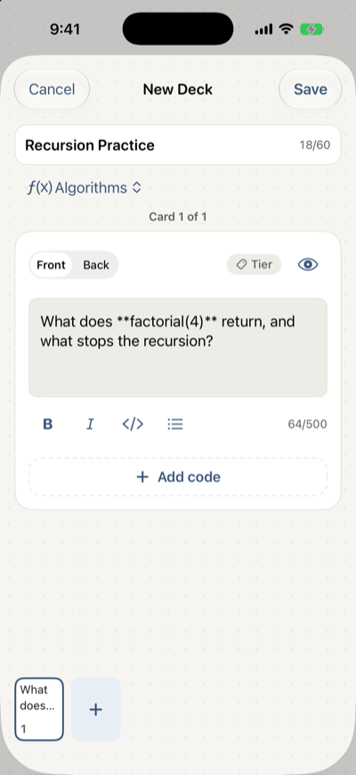
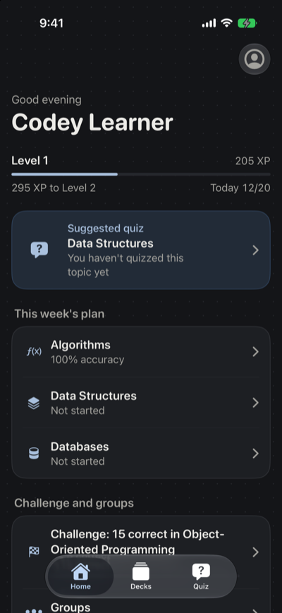

<div align="center">


# Codey

**Gamified computer-science study app for iOS.**<br>
Flashcards with code · adaptive quizzes · XP, streaks, badges · group leaderboards


&nbsp;
&nbsp;

<br><br>
&nbsp;
&nbsp;


</div>

## Features

- **Flashcard decks** — starter decks per CS topic + your own, with syntax-highlighted code
- **Study mode** — flip, rate (Again / Hard / Good / Easy), track **mastery**
- **Quizzes** — **Easy / Medium / Hard** tiers, explanations, streak bonuses
- **Progress** — **XP**, levels, daily streaks, badges, weekly challenges
- **Groups** — join by code, weekly **leaderboard**
- **Offline-first** — works fully without an account; sign in with Google to **sync**
- **Light + Dark** mode, **VoiceOver** support

## Requirements

- Apple Silicon Mac, **macOS 27+**
- **Xcode 27.2** + iOS Simulator runtime
- **Tuist** (`brew install tuist`)

## Quick start

1. Clone
   ```bash
   git clone https://github.com/raajbanga/codey.git && cd codey
   ```
2. Fetch packages
   ```bash
   tuist install
   ```
3. Generate + open the workspace
   ```bash
   tuist generate
   ```
4. In Xcode: scheme **codey** → **iPhone 17** Simulator → **⌘R**

- No keys needed — runs in **local-only mode** (everything except sign-in, sync, groups)

## Backend (optional)

- Turns on **Google sign-in**, **sync**, **groups**
- Copy the secrets template, then fill it in
  ```bash
  cp Config/Secrets.example.xcconfig Config/Secrets.xcconfig
  ```
- Supabase + Google OAuth setup → [`supabase/README.md`](supabase/README.md)
- **Never commit** `Secrets.xcconfig`; never use the `service_role` key

## Tests

- Unit tests
  ```bash
  xcodebuild test -workspace codey.xcworkspace -scheme codey -destination 'platform=iOS Simulator,name=iPhone 17' -only-testing:codeyTests
  ```
- UI tests → same command with `-only-testing:codeyUITests` (run suites one at a time)
- Repo checks
  ```bash
  scripts/check-imports.sh
  ```
  ```bash
  scripts/check-design-tokens.sh
  ```
  ```bash
  scripts/check-secrets.sh
  ```

## Project layout

| Path | What |
| --- | --- |
| `codey/Sources` | App code (Features, ViewModels, Models, Services, DesignSystem) |
| `codey/Tests`, `codey/UITests` | Unit + UI tests |
| `supabase/` | Database migrations, RLS policies, tests |
| `scripts/` | Repo checks, perf + backup tools |
| `docs/` | Sprint reports (PDF); LaTeX sources in `docs/source/` |

## Docs

- [Sprint 3 report](docs/Sprint3_Documentation.pdf) · [reading copy](docs/Sprint3_Documentation_reading.pdf)
- [Sprint 2 report](docs/Sprint2_Documentation.pdf)
- Full build guide → Appendix A of the Sprint 3 report

## Team

- **Raaj Banga** — project manager
- **Arnav Bawankule** — backend
- **Elnad Salcinovic** — UI/UX, QA

<sub>CS 360 · Western Kentucky University</sub>
