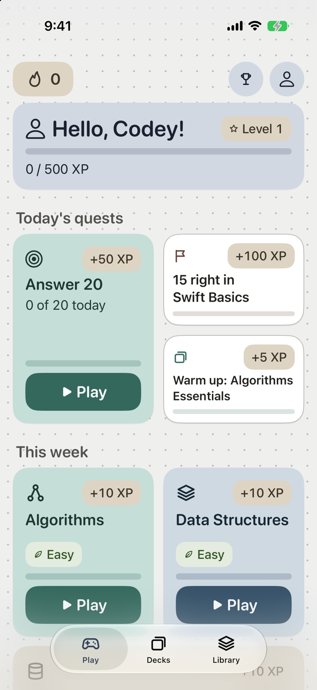
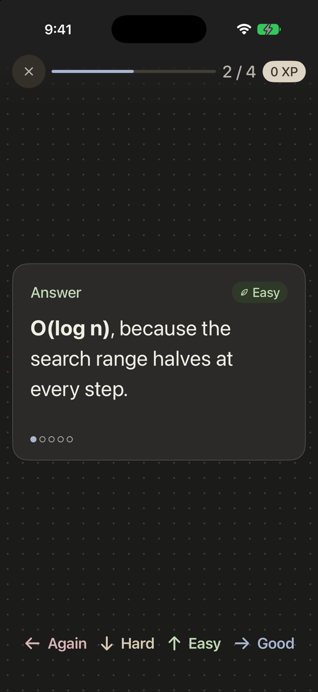
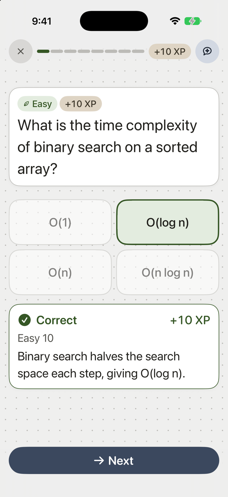
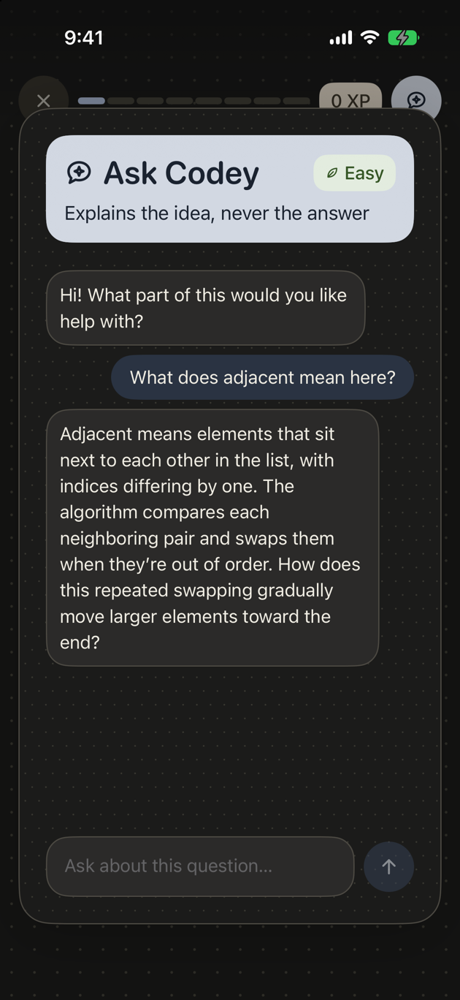
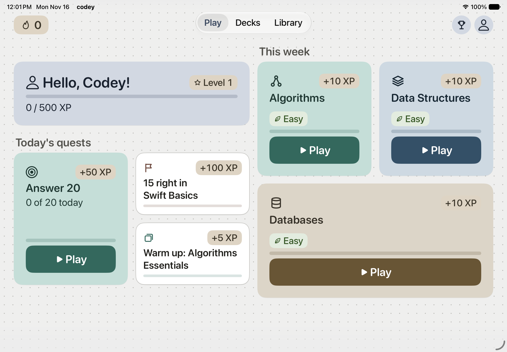
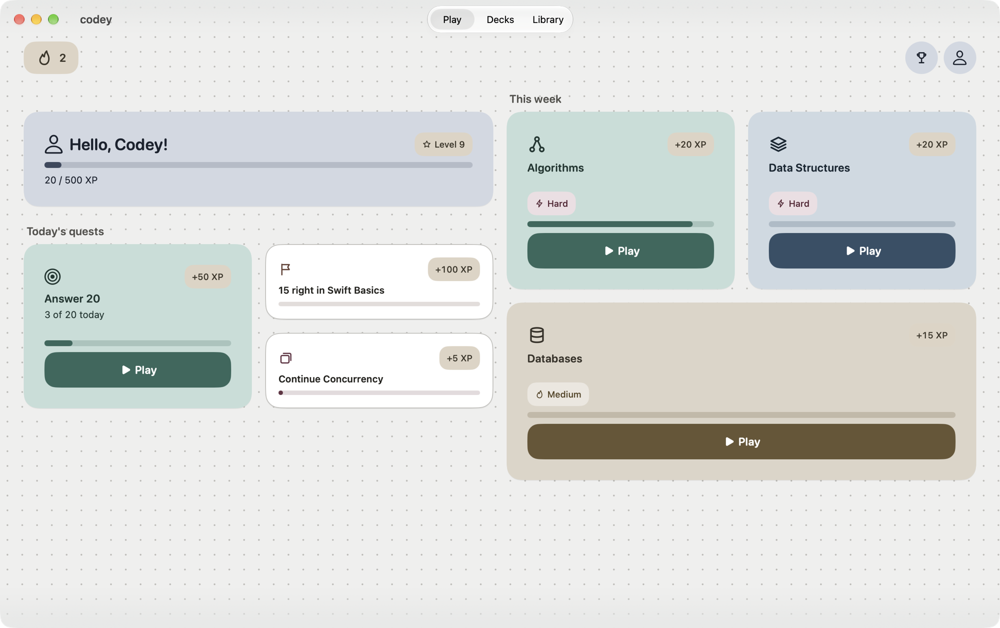
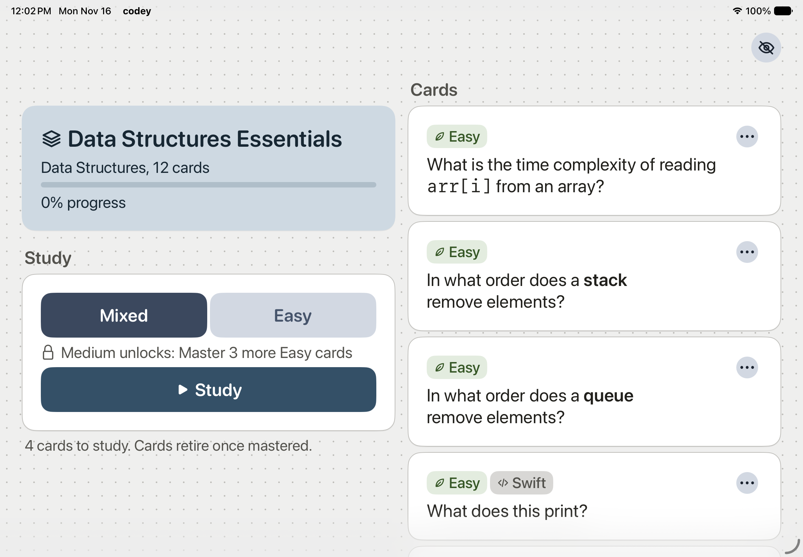
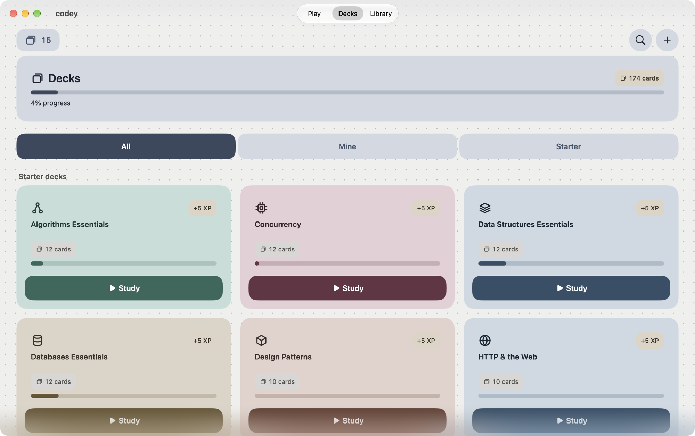
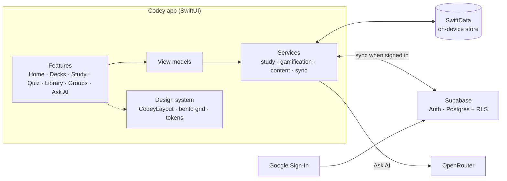

<div align="center">


# Codey

**Learn computer science one card at a time.**<br>
Flashcards with real code, adaptive quizzes, and an AI tutor, built as a game for iPhone, iPad and Mac.

[](#getting-started)
[](https://www.swift.org)
[](#tech-stack)
[](https://github.com/raajbanga/codey/actions/workflows/test.yml)
[](supabase/README.md)
[](https://tuist.dev)

[Features](#features) · [Screenshots](#screenshots) · [Getting started](#getting-started) · [Architecture](#architecture) · [Testing](#testing) · [Docs](#documentation)

<br>

&nbsp;&nbsp;
&nbsp;&nbsp;


</div>

## About

Codey is a study app for computer-science students. Starter decks cover the core
topics (algorithms, data structures, databases, networking, operating systems and
more), and you can write your own cards with syntax-highlighted code. Every study
session, quiz and coding exercise earns XP toward levels, streaks, badges and a
weekly group leaderboard.

It is **offline-first**: everything works without an account, on device, with
SwiftData. Signing in with Google adds sync across devices and groups.

## Features

| | |
| --- | --- |
| 🃏 **Flashcard decks** | Starter decks for each CS topic, plus your own, with syntax-highlighted Swift, Python, Java and C++ |
| 🧠 **Study mode** | Flip, rate *Again / Hard / Good / Easy*, and watch cards retire as you master them |
| 🎯 **Quizzes** | *Easy / Medium / Hard* tiers that unlock as you improve, with explanations and streak bonuses |
| 💻 **Coding exercises** | Short problems in a real code editor, by topic |
| ✨ **Ask AI tutor** | Ask about a quiz question or exercise and get help understanding it; it never gives the answer away |
| 🏆 **Progress** | XP, levels, daily streaks, badges, daily quests and weekly challenges |
| 👥 **Groups** | Create or join with a 6-character code and race on a weekly XP board |
| ☁️ **Sync** | Offline-first; sign in with Google to back up and sync across devices |
| ♿ **Accessible** | Light and dark mode, Dynamic Type, VoiceOver, and an automated accessibility audit in CI |

## Screenshots

<table>
  <tr>
    <td align="center"><br><sub>Decks</sub></td>
    <td align="center"><br><sub>Ask AI tutor</sub></td>
    <td align="center"><br><sub>Coding exercise</sub></td>
  </tr>
</table>

<details open>
<summary><b>iPad and Mac</b>: wide windows split into two columns</summary>
<br>

| iPad (landscape) | Mac (Mac Catalyst) |
| --- | --- |
|  |  |
|  |  |

</details>

## Getting started

### Requirements

- Apple Silicon Mac with **macOS 27+** and **Xcode 27.2** (with the iOS Simulator runtime)
- [**Tuist**](https://tuist.dev) 4: `brew install tuist` (tested with 4.214.1)

### Run it

```bash
git clone https://github.com/raajbanga/codey.git
cd codey
tuist install    # fetch Swift packages
tuist generate   # generate and open the workspace
```

In Xcode, pick the **codey** scheme and a run destination, then press **⌘R**:

| Destination | Notes |
| --- | --- |
| iPhone 17 Simulator | The phone layout |
| iPad (A16) Simulator | Two columns in landscape |
| My Mac (Mac Catalyst) | Needs your `DEVELOPMENT_TEAM` (see below) |

> [!NOTE]
> No keys are needed. Without a backend the app runs in **local-only mode**: decks,
> study, quizzes, exercises and progress all work; sign-in, sync, groups and Ask AI need the keys below.

### Configuration (optional)

Copy the template and fill in the keys you need:

```bash
cp Config/Secrets.example.xcconfig Config/Secrets.xcconfig
```

| Key | Turns on |
| --- | --- |
| `SUPABASE_URL`, `SUPABASE_ANON_KEY` | Sync and groups ([setup guide](supabase/README.md)) |
| `GOOGLE_IOS_CLIENT_ID`, `GOOGLE_REVERSED_CLIENT_ID`, `GOOGLE_SERVER_CLIENT_ID` | Google sign-in |
| `OPENROUTER_API_KEY`, `OPENROUTER_MODEL` | The Ask AI tutor (a free [OpenRouter](https://openrouter.ai) model) |
| `DEVELOPMENT_TEAM` | Running on a device or on the Mac |

> [!WARNING]
> `Config/Secrets.xcconfig` is gitignored: never commit it, and never put the
> Supabase `service_role` key in the app.

## Architecture



- **Offline-first.** SwiftData is the source of truth; a sync engine pushes and pulls
  changes with Supabase and merges conflicts additively, so no progress is lost.
- **One layout layer.** The window's size class is read once, at the root, and shared
  components (`CodeyPage`, `BentoGrid`, `GameTile`) adapt to it, so iPhone, iPad and
  Mac share every screen.
- **Locked-down backend.** Row Level Security on every table, a server-side weekly-XP
  pace limit, and versioned SQL migrations in [`supabase/migrations`](supabase/migrations).

## Tech stack

| Area | Built with |
| --- | --- |
| App | Swift 6, SwiftUI, SwiftData, Swift Concurrency |
| Code cards and editor | [Runestone](https://github.com/simonbs/Runestone) + [TreeSitterLanguages](https://github.com/simonbs/TreeSitterLanguages), [Textual](https://github.com/gonzalezreal/textual) for Markdown |
| Backend | [Supabase](https://supabase.com) (Auth, Postgres, Row Level Security) via [supabase-swift](https://github.com/supabase/supabase-swift) |
| Sign-in | [GoogleSignIn-iOS](https://github.com/google/GoogleSignIn-iOS) |
| AI tutor | [OpenRouter](https://openrouter.ai) chat completions |
| Project and CI | [Tuist](https://tuist.dev), GitHub Actions, pgTAP |

## Testing

```bash
scripts/test.sh                 # unit tests + accessibility audit, with a readable report
COVERAGE=1 scripts/test.sh      # add line coverage by folder
supabase db start && supabase test db   # database tests (needs the Supabase CLI and Docker)
```

Pass any `-only-testing:` filter to `scripts/test.sh` to run less, for example
`scripts/test.sh -only-testing:codeyUITests/DeckBuilderUITests`. The raw `xcodebuild`
output lands in `build/test.log`.

| Check | What it guards |
| --- | --- |
| [CI](.github/workflows/test.yml) | Every push to `main` or `dev` and every PR: repo checks, pgTAP, unit tests and the accessibility audit (report and coverage in the job summary), Release build |
| `scripts/check-imports.sh` | Only the backend layer imports Supabase and Google Sign-In |
| `scripts/check-design-tokens.sh` | The design-system rules (tokens instead of raw values) hold |
| `scripts/check-secrets.sh` | No keys are staged |
| `scripts/check-release-build.sh` | The Release build has no Debug-only test client or component gallery |

## Project structure

```
codey/
├── codey/
│   ├── Sources/
│   │   ├── App/            # launch, configuration
│   │   ├── Features/       # screens: Home, Decks, Study, Quiz, Library, Groups, AskAI, Profile
│   │   ├── ViewModels/
│   │   ├── Models/         # SwiftData models
│   │   ├── Services/       # study, gamification, content, sync, backend, Ask AI
│   │   ├── DesignSystem/   # tokens, components, layout
│   │   └── Navigation/
│   ├── Tests/              # unit tests
│   └── UITests/            # UI tests and the screenshot tour
├── supabase/               # migrations, RLS policies, pgTAP tests, setup guide
├── scripts/                # repo checks, test runner, perf and backup tools
├── docs/                   # final report (PDF) and its LaTeX source and figures
└── Project.swift           # Tuist manifest
```

## Documentation

- 📄 [Final report](docs/Final_Documentation.pdf) ([reading copy](docs/Final_Documentation_reading.pdf), without the code listings): requirements, design, testing and the full build guide (Appendix A)
- 🗄️ [Backend setup](supabase/README.md): Supabase and Google OAuth

## Team

<table>
  <tr>
    <td align="center"><a href="https://github.com/raajbanga"><br><b>Raaj Banga</b></a><br><sub>Project manager</sub></td>
    <td align="center"><a href="https://github.com/TheRealAxnav"><br><b>Arnav Bawankule</b></a><br><sub>Backend</sub></td>
    <td align="center"><a href="https://github.com/elnadsalcinovic2005-oss"><br><b>Elnad Salcinovic</b></a><br><sub>UI/UX and QA</sub></td>
  </tr>
</table>

<div align="center">
<sub>CS 360 · Western Kentucky University</sub>
</div>
