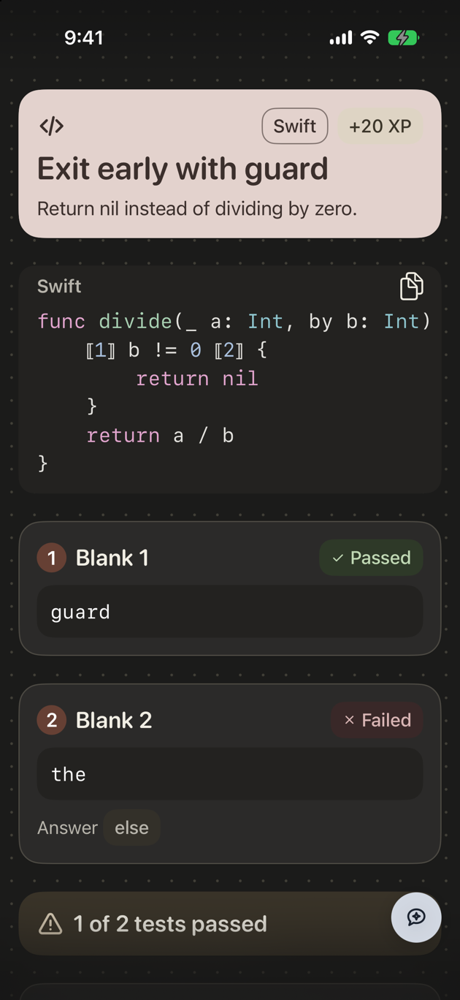
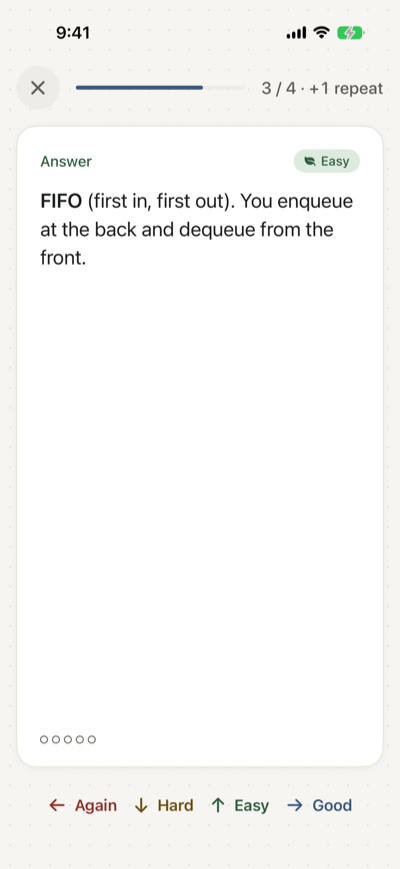

<div align="center">


# Codey

**Gamified computer-science study app for iOS.**<br>
Flashcards with code · adaptive quizzes · XP, streaks, badges · group leaderboards


[](https://github.com/raajbanga/codey/actions/workflows/test.yml)


&nbsp;
&nbsp;

<br><br>
&nbsp;
&nbsp;


</div>

## Features

- **Flashcard decks** — starter decks per CS topic + your own, with syntax-highlighted code
- **Study mode** — flip, rate (Again / Hard / Good / Easy), track **mastery**
- **Quizzes** — **Easy / Medium / Hard** tiers, explanations, streak bonuses
- **Progress** — **XP**, levels, daily streaks, badges, weekly challenges
- **Groups** — join by code, weekly **leaderboard**
- **Offline-first** — works fully without an account; sign in with Google to **sync**
- **Light + Dark** mode, **VoiceOver** support

## Requirements

- Apple Silicon Mac, **macOS 27+**
- **Xcode 27.2** + iOS Simulator runtime
- **Tuist** (`brew install tuist`; tested with 4.214.1)

## Quick start

1. Clone
   ```bash
   git clone https://github.com/raajbanga/codey.git && cd codey
   ```
2. Fetch packages
   ```bash
   tuist install
   ```
3. Generate + open the workspace
   ```bash
   tuist generate
   ```
4. In Xcode: scheme **codey** → **iPhone 17** Simulator → **⌘R**

- No keys needed — runs in **local-only mode** (everything except sign-in, sync, groups)

## Backend (optional)

- Turns on **Google sign-in**, **sync**, **groups**
- Copy the secrets template, then fill it in
  ```bash
  cp Config/Secrets.example.xcconfig Config/Secrets.xcconfig
  ```
- Supabase + Google OAuth setup → [`supabase/README.md`](supabase/README.md)
- **Never commit** `Secrets.xcconfig`; never use the `service_role` key

## Tests

- Unit tests + accessibility audit, with a readable report (every test ✓/✗ by suite, failures, totals)
  ```bash
  scripts/test.sh
  ```
  `COVERAGE=1` adds line coverage by folder; pass any `-only-testing:` filter to run less (e.g. `scripts/test.sh -only-testing:codeyUITests/DeckBuilderUITests`). Raw xcodebuild output is in `build/test.log`.
- Database (pgTAP: RLS, constraints, weekly-XP pace limit, FR-61 merge rules; needs the Supabase CLI + Docker)
  ```bash
  supabase db start && supabase test db
  ```
- CI → [`.github/workflows/test.yml`](.github/workflows/test.yml) runs the repo checks, the pgTAP tests, the unit tests + accessibility audit (report and coverage in the job summary) and the Release-build check on every push to `main`/`dev` and every PR to `main`
- Repo checks
  ```bash
  scripts/check-imports.sh
  ```
  ```bash
  scripts/check-design-tokens.sh
  ```
  ```bash
  scripts/check-secrets.sh
  ```
  ```bash
  scripts/check-release-build.sh
  ```
  (Release build has no DEBUG-only test client or component gallery)

## Project layout

| Path | What |
| --- | --- |
| `codey/Sources` | App code (Features, ViewModels, Models, Services, DesignSystem) |
| `codey/Tests`, `codey/UITests` | Unit + UI tests |
| `supabase/` | Database migrations, RLS policies, tests |
| `scripts/` | Repo checks, perf + backup tools |
| `.github/workflows/` | CI (tests) + Supabase keep-alive |
| `docs/` | Final report (PDF); LaTeX source in `docs/source/`; README screenshots in `docs/screenshots/`; course material in `docs/course/` |

## Docs

- [Final report](docs/Final_Documentation.pdf) · [reading copy](docs/Final_Documentation_reading.pdf)
- Full build guide → Appendix A of the final report

## Team

- **Raaj Banga** — project manager
- **Arnav Bawankule** — backend
- **Elnad Salcinovic** — UI/UX, QA

<sub>CS 360 · Western Kentucky University</sub>
